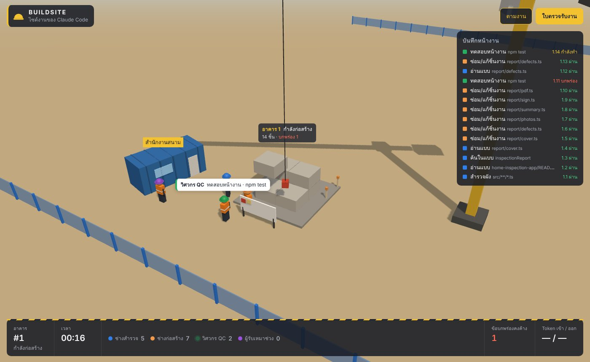
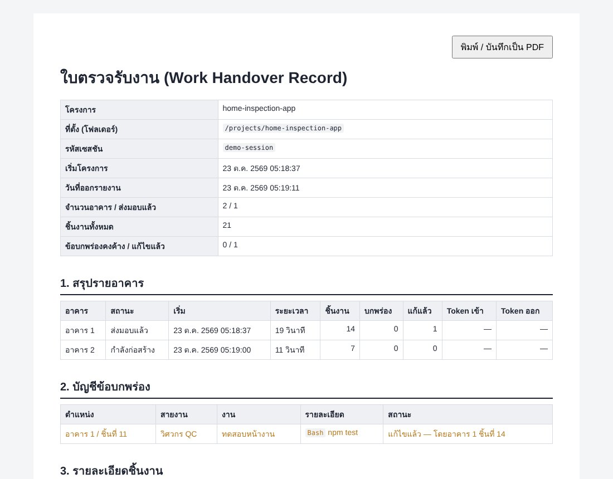

# Buildsite — ไซต์ก่อสร้างของ Claude Code

**ดูการทำงานของ Claude Code เป็นไซต์ก่อสร้าง 3D แบบสด ๆ** ทุกคำสั่งที่คุณพิมพ์คือการสร้างอาคารหนึ่งหลัง ทุกครั้งที่ Claude ใช้เครื่องมือคือชิ้นงานหนึ่งชิ้น งานที่ล้มเหลวจะกลายเป็น "ข้อบกพร่อง" สีแดงจนกว่าจะถูกแก้ และทุกโครงการออก **ใบตรวจรับงาน** พิมพ์เป็น PDF ได้

ทำงานในเครื่องคุณเท่านั้น · อ่านอย่างเดียว · ไม่ต้องติดตั้ง npm · MIT

[English](README.en.md)



## ฉากนี้อ่านอย่างไร

| บนไซต์ | ความหมายใน Claude Code |
|---|---|
| **อาคาร 1 หลัง** | คำสั่ง (prompt) 1 ครั้ง ตั้งแต่ส่งจนถึงตอบเสร็จ |
| **ชิ้นงาน** | การเรียกเครื่องมือ 1 ครั้ง |
| **ช่างสำรวจ** (หมวกน้ำเงิน) | อ่าน/ค้นไฟล์, ค้นเว็บ, MCP → ปักหมุดสำรวจรอบแปลง |
| **ช่างก่อสร้าง** (หมวกส้ม) | แก้/เขียนไฟล์, รันคำสั่งทั่วไป → ก่อบล็อกคอนกรีตขึ้นทีละชั้น เครนยกให้ |
| **วิศวกร QC** (หมวกเขียว) | รันเทส/build/lint → ติดป้ายตรวจบนบอร์ดหน้าแปลง |
| **ผู้รับเหมาช่วง** (หมวกม่วง) | subagent → นั่งร้านข้างอาคาร |
| ชิ้นงานโปร่งสีเหลืองกะพริบ | กำลังทำ |
| **สีแดง / มีรอยร้าว** | ข้อบกพร่อง: เครื่องมือรายงานว่าล้มเหลว |
| **แถบสีเหลืองปะ** | แก้แล้ว: เรียกเครื่องมือเดิมกับเป้าหมายเดิมแล้วผ่าน |
| หลังคา + ธงเขียว | ส่งมอบแล้ว (Claude ตอบจบ) |
| กรวยจราจรส้ม | หยุดงานกลางคัน (ถูกขัดจังหวะ หรือส่งคำสั่งใหม่ก่อนจบ) |
| ป้าย "วางแผน / เขียนคำตอบ…" ที่สำนักงานสนาม | Claude กำลังคิดหรือเขียนข้อความ โดยไม่มีเครื่องมือทำงาน |

อาคารที่สร้างเสร็จจะ **อยู่บนไซต์ต่อ** ทำให้มองย้อนดูได้ว่าเซสชันนี้ทำงานไปแล้วกี่หลัง แผงขวาคือบันทึกหน้างาน แถบล่างแสดงเวลา จำนวนชิ้นงานต่อสายงาน ข้อบกพร่องคงค้าง และ token ของอาคารปัจจุบัน

ลากเมาส์เพื่อหมุนกล้อง, Shift+ลาก หรือคลิกขวาลากเพื่อเลื่อน, ล้อเมาส์เพื่อซูม, ปุ่ม **ตามงาน** ให้กล้องตามอาคารล่าสุด

## ติดตั้ง

ต้องมี Claude Code, Node.js 18.17 ขึ้นไป และ git

```bash
claude plugin marketplace add narisunt-ctrl/claude-buildsite
claude plugin install buildsite@claude-buildsite
```

จากนั้น **เริ่มเซสชัน Claude Code ใหม่** (hook โหลดตอนเริ่มเซสชัน) แล้วเปิด

```
http://127.0.0.1:4646/
```

หรือพิมพ์ `/buildsite:site` ใน Claude Code เพื่อเปิดหน้าเว็บให้อัตโนมัติ ถ้าพอร์ต 4646 ถูกใช้อยู่ จะสลับไปพอร์ตว่างเอง และ `/buildsite:site` จะบอกที่อยู่จริง

### ลองดูก่อนโดยไม่ต้องมี Claude Code

```bash
git clone https://github.com/narisunt-ctrl/claude-buildsite.git
cd claude-buildsite/server
npm run demo       # เปิด http://127.0.0.1:4646/
```

## ใบตรวจรับงาน

ปุ่ม **ใบตรวจรับงาน** มุมขวาบนจะเปิดรายงานของโครงการที่ดูอยู่: ข้อมูลโครงการ, สรุปรายอาคาร (เวลา, ชิ้นงาน, token), บัญชีข้อบกพร่อง พร้อมระบุว่าถูกแก้โดยชิ้นงานใด และรายละเอียดทุกชิ้นงาน กด "พิมพ์ / บันทึกเป็น PDF" เพื่อเก็บไว้



## ปรับสายงานเอง

กฎจับคู่เครื่องมือกับสายงานอยู่ใน [`server/config/trades.json`](server/config/trades.json) ถ้าอยากเปลี่ยน ให้คัดลอกไฟล์นั้นไปไว้ที่ `~/.buildsite/trades.json` แล้วแก้ได้เลย (เปลี่ยนชื่อสายงาน สี คำกริยา หรือ regex ของคำสั่งทดสอบ) จากนั้นปิด server ด้วยการ kill process ที่ระบุใน `~/.buildsite/server.json` แล้วรอให้ hook ถัดไปเปิดใหม่

กฎถูกตรวจจากบนลงล่าง ใช้ `tool` (ชื่อหรือรายการชื่อ), `toolPrefix` (เช่น `mcp__`) และ `commandMatch` (regex สำหรับ Bash) กฎที่เขียนผิดจะถูกข้ามทีละข้อ ไม่ทำให้ทั้งไฟล์ใช้ไม่ได้

## ความเป็นส่วนตัวและความปลอดภัย

- server ฟังเฉพาะ `127.0.0.1` ตรวจ `Host` (กัน DNS rebinding), ตรวจ `Origin` และรับเฉพาะ `application/json` (กันเว็บอื่นยิงเข้ามา)
- hook ส่งเฉพาะ: ชื่อ event, รหัสเซสชัน, โฟลเดอร์, ชื่อเครื่องมือ, path ไฟล์/คำสั่ง/คำค้น (ตัดความยาว) **ไม่ส่ง** prompt, เนื้อหาไฟล์, ผลลัพธ์เครื่องมือ หรือข้อความ error
- server ตัดข้อมูลซ้ำอีกชั้น และหน้าเว็บได้เห็นแค่ชื่อไฟล์ 2 ระดับสุดท้าย
- token อ่านเฉพาะตัวเลข usage จากไฟล์ transcript ที่อยู่ในโฟลเดอร์ `~/.claude` เท่านั้น
- hook ไม่พิมพ์อะไรออกมาเลย ใช้เวลาน้อยกว่า 0.1 วินาทีเมื่อ server ทำงานอยู่ และจบด้วย exit 0 เสมอ จึงไม่ทำให้ Claude Code ช้าหรือพัง
- ปิดชั่วคราวได้ด้วย environment variable `BUILDSITE_OFF=1`
- server ปิดตัวเองเมื่อไม่มี event และไม่มีหน้าเว็บเปิดอยู่ครบ 1 ชั่วโมง

## โครงสร้าง

```
.claude-plugin/        manifest ของ plugin และ marketplace
hooks/hooks.json       ลงทะเบียน hook (async ทั้งหมด)
commands/site.md       คำสั่ง /buildsite:site
bin/                   hook.mjs (ตัดข้อมูลแล้วส่ง), open.mjs, common.mjs
server/
  config/trades.json   กฎสายงาน
  src/intake.js        แปลง payload ของ hook → event ของไซต์ (whitelist)
  src/site.js          โมเดลไซต์: โครงการ → อาคาร → ชิ้นงาน, ข้อบกพร่อง/การแก้
  src/usage.js         อ่าน token แบบต่อเนื่อง นับครั้งเดียวต่อ message id
  src/report.js        ใบตรวจรับงาน (HTML)
  src/server.js        HTTP + SSE + ตรวจ Host/Origin
  src/daemon.js        รันเบื้องหลัง, lock ด้วย mkdir, ปิดเองเมื่อว่าง
  web/                 หน้าเว็บ, ฉาก three.js, vendor/
  test/                เทสด้วย node:test
  scripts/demo.js      เซสชันจำลอง
```

```
Claude Code ──hook (stdin JSON)──▶ bin/hook.mjs ──POST /event──▶ server (127.0.0.1)
      └──── transcript .jsonl (ตัวเลข usage เท่านั้น) ─────────▶   │ SSE
                                                                    ▼
                                                        เบราว์เซอร์: ฉาก three.js
```

## พัฒนาต่อ

```bash
cd server
npm test           # เทสทั้งหมด
npm run demo       # ฉากจำลองวนซ้ำ
claude --plugin-dir ..   # โหลด plugin จากโฟลเดอร์นี้สำหรับเซสชันเดียว
```

ดีบัก hook: ตั้ง `BUILDSITE_DEBUG=1` แล้วดู `~/.buildsite/hook.log`

## ข้อจำกัด

- รูปแบบไฟล์ transcript ของ Claude Code ไม่ใช่ API สาธารณะ ถ้าเปลี่ยนรูปแบบ ตัวนับ token จะแสดง "—"
- "ข้อบกพร่อง" มาจาก event `PostToolUseFailure` เท่านั้น เทสที่รันจบแต่ผลไม่ผ่านอาจไม่นับเป็นข้อบกพร่อง ขึ้นกับว่า Claude Code รายงานอย่างไร
- ตัวละครเป็นเพียงอุปมา ไม่ได้แทน AI หลายตัวจริง
- ทดสอบ server, hook และหน้าเว็บบน Linux (Node 22, Chromium) และผ่าน `claude plugin validate` แล้ว ยังไม่ได้ทดสอบในเซสชัน Claude Code จริง และยังไม่ได้ลองบน Windows/macOS ถ้าเจอปัญหาแจ้งใน Issues ได้

## ที่มาและสัญญาอนุญาต

MIT © 2026 Narisan Nakakes · ใช้ [three.js](https://threejs.org/) (MIT) · แนวคิดเริ่มต้นได้แรงบันดาลใจจาก [claude-code-3d](https://github.com/thekaroe-thailand/claude-code-3d) โดยเขียนใหม่ทั้งหมดเป็นงานอิสระ ดู [NOTICE.md](NOTICE.md)
